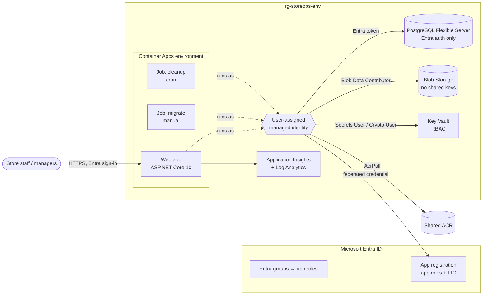

# Azure Entra + PostgreSQL Starter: passwordless internal apps on Azure Container Apps

[](../../actions/workflows/ci.yml)
[](../../actions/workflows/deploy.yml)

A reference implementation of how I build and deploy **internal line-of-business apps on Azure**:
Entra ID sign-in with **app roles**, **PostgreSQL with no password anywhere**, infrastructure in
**Bicep** for dev/test/prod, and **GitHub Actions with OIDC** (no deployment secrets).

The sample app, *StoreOps*, lets retail store staff upload daily reports (cash counts,
inventory sheets) and lets managers approve them. The business logic is deliberately small; the
platform around it is the point of this repository.

> **Zero secrets.** No database password, no client secret, no storage key, no deployment
> credential. Every component authenticates with Microsoft Entra ID.

---

## What this repository demonstrates

| Concern | How it is done here |
|---|---|
| **Hosting** | Azure Container Apps (web app + Container Apps Jobs), images in Azure Container Registry |
| **User sign-in** | Microsoft Entra ID (OpenID Connect, Microsoft.Identity.Web) |
| **Page access** | Entra **app roles** → ASP.NET Core policies → Razor Pages folder/page conventions. Groups are assigned to roles in Entra, so access changes need no code change |
| **App's client credential** | **Federated identity credential** backed by the managed identity (`SignedAssertionFromManagedIdentity`), so there is **no client secret** |
| **Database** | Azure Database for PostgreSQL Flexible Server, **Entra-only auth** (`passwordAuth: Disabled`). The app connects with a short-lived token from its **managed identity**, refreshed by Npgsql |
| **DB permissions** | Pipeline maps the managed identity to a PostgreSQL role (`pgaadauth_create_principal_with_oid`) with least-privilege grants |
| **Files** | Blob Storage with **shared-key access disabled**, accessed by RBAC through the managed identity, streamed through the app (no public or SAS URLs) |
| **Secrets** | Key Vault (RBAC mode) for third-party secrets, referenced by Container Apps through the managed identity. Key Vault also holds the key that wraps ASP.NET Core data-protection keys |
| **Scheduled jobs** | Container Apps Job on a cron schedule (retention cleanup) |
| **Migrations** | Container Apps Job started by the pipeline. Forward-only SQL scripts, advisory lock, one transaction each |
| **Observability** | OpenTelemetry → Application Insights. Container logs → Log Analytics. Liveness and readiness endpoints |
| **IaC** | Bicep modules, one `.bicepparam` per environment, linter with strict rules |
| **CI/CD** | GitHub Actions: build & test, Bicep lint, **what-if on PRs**, build once → promote **dev → test → prod** (prod gated by reviewers), one-click **rollback** to any previous image tag |
| **Pipeline auth** | **OIDC federated credentials**. The deployer's role-assignment rights are restricted by an **ABAC condition** to the 4 roles the templates use |
| **Tests** | xUnit + `WebApplicationFactory`: the full **role → page access matrix**, domain rules, upload validation |

## Architecture



More detail and design decisions: [docs/architecture.md](docs/architecture.md).
Moving a live app onto this platform: [docs/migration-runbook.md](docs/migration-runbook.md).

## Repository layout

```
.github/workflows/
  ci.yml                      build, test, Bicep lint, what-if on PRs
  deploy.yml                  build once -> dev -> test -> prod
  deploy-environment.yml      reusable: what-if, deploy, DB grant, migrations, smoke test
  rollback.yml                redeploy a previous image tag to one environment
infra/
  main.bicep                  one environment (subscription scope)
  shared.bicep                shared container registry
  modules/                    identity, monitoring, storage, keyvault, postgres, container-apps, registry
  parameters/                 dev / test / prod .bicepparam
scripts/
  bootstrap/github-oidc.sh    deployment identity for GitHub Actions (OIDC + restricted RBAC)
  entra/                      app registration, app roles, group assignment, redirect URI + FIC
  db/grant-db-access.sh       managed identity -> PostgreSQL role (idempotent)
  ops/run-job.sh              start a Container Apps Job and wait for the result
src/
  StoreOps.Core/              data access (Npgsql + Entra tokens), blob storage, migrations, domain
  StoreOps.Web/               Razor Pages app, Entra sign-in, role-based pages
  StoreOps.Jobs/              migrate / cleanup commands for Container Apps Jobs
tests/StoreOps.Web.Tests/     access matrix, domain and validation tests
```

## Key code paths

- **Passwordless PostgreSQL**: [`PostgresDataSourceFactory.cs`](src/StoreOps.Core/Data/PostgresDataSourceFactory.cs) uses `UsePeriodicPasswordProvider` to fetch an Entra token for `https://ossrdbms-aad.database.windows.net/.default`
- **Role → page mapping**: [`Program.cs`](src/StoreOps.Web/Program.cs) (folder and page conventions) and [`Policies.cs`](src/StoreOps.Web/Authorization/Policies.cs)
- **Access matrix tests**: [`PageAuthorizationTests.cs`](tests/StoreOps.Web.Tests/PageAuthorizationTests.cs)
- **Entra-only PostgreSQL**: [`postgres.bicep`](infra/modules/postgres.bicep)
- **No client secret for sign-in**: `AzureAd__ClientCredentials__0__SourceType` in [`container-apps.bicep`](infra/modules/container-apps.bicep) and the FIC in [`register-environment.sh`](scripts/entra/register-environment.sh)
- **DB role for the managed identity**: [`grant-db-access.sh`](scripts/db/grant-db-access.sh)

## Run it locally

Prerequisites: .NET 10 SDK and Docker.

```bash
docker compose up -d                               # local PostgreSQL (password auth, local only)
Postgres__Password=local-dev-only dotnet run --project src/StoreOps.Jobs -- migrate   # create the schema
```

For sign-in, use the **dev** app registration (see below) and a client secret kept in
user-secrets. This secret is for local development only; deployed environments use the federated
credential instead.

```bash
cd src/StoreOps.Web
dotnet user-secrets init
dotnet user-secrets set "AzureAd:TenantId" "<tenant-id>"
dotnet user-secrets set "AzureAd:ClientId" "<dev-app-client-id>"
dotnet user-secrets set "AzureAd:ClientSecret" "<dev-only-secret>"
dotnet run --launch-profile https                  # https://localhost:7093
```

Run the tests (no Azure or database needed):

```bash
dotnet test
```

## Deploy to your own subscription

Run the scripts from Azure Cloud Shell (Bash), WSL, Linux or macOS. You need `az` and `jq`, and an
account allowed to create app registrations and role assignments.

1. **Deployment identity for GitHub Actions** (OIDC, no secret):
   ```bash
   bash scripts/bootstrap/github-oidc.sh <owner>/<repo>
   ```
   Add the printed values as **repository variables**. Create the GitHub environments `dev`,
   `test` and `prod`, and add required reviewers on `prod`.

2. **App registration per environment** (app roles, optional group assignment):
   ```bash
   STAFF_GROUP_ID=<id> MANAGER_GROUP_ID=<id> ADMIN_GROUP_ID=<id> \
     bash scripts/entra/create-app-registration.sh dev
   ```
   Add `ENTRA_CLIENT_ID_DEV` (and `_TEST`, `_PROD`) as repository variables.

3. **Push to `main`.** The Deploy workflow builds the images and deploys dev, then test, then
   prod. For each environment it runs what-if, Bicep, the database grant, the migrations and a
   smoke test.

4. **Connect sign-in**, once per environment after its first deployment:
   ```bash
   bash scripts/entra/register-environment.sh dev
   ```

Optional repository variables: `AZURE_LOCATION` (default `canadacentral`), and
`DBA_GROUP_OBJECT_ID` / `DBA_GROUP_NAME` for a human DBA group as PostgreSQL Entra admin.

### Rollback

**Actions → Rollback → Run workflow**, then choose the environment and a previous image tag. The
same pipeline runs (what-if, deploy, smoke test). Schema changes follow the expand/contract
pattern, so the previous version still works with the current schema (see the runbook).

## Production hardening (not enabled in this demo)

This demo uses a public PostgreSQL endpoint (Entra token required) and public ingress, to keep it
cheap and easy to try. For a production workload I would add:

- VNet-integrated Container Apps environment, with **private endpoints** for PostgreSQL, Storage, Key Vault and ACR
- Azure Front Door + WAF in front of the web app, or internal-only ingress for staff on the corporate network/VPN
- Alerts (failed job executions, 5xx rate, DB CPU and storage) routed to the on-call channel
- Microsoft Defender for Cloud, diagnostic settings on every resource, resource locks on prod
- A Conditional Access policy for the app (compliant device / MFA)

## License

[MIT](LICENSE)
