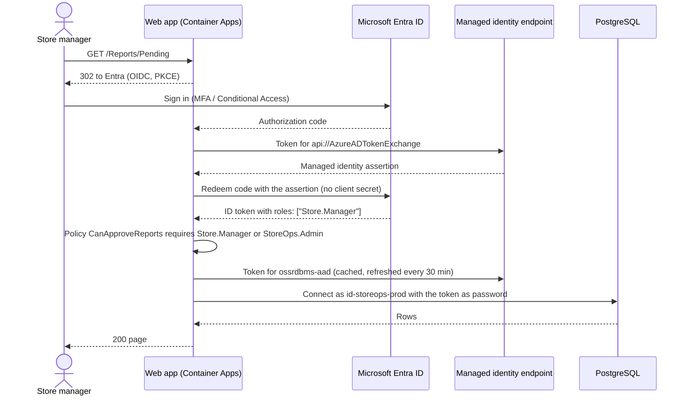

# Architecture & design decisions

## Request flow

## Decisions

### Container Apps rather than App Service
Both are good fits. Container Apps was chosen because:
- **Jobs** (manual and cron) run on the same environment, image and identity as the web app. That covers scheduled tasks and migrations without a separate service.
- Scale to zero for dev and test keeps their cost close to zero.
- The deployment unit is a container image, so the artifact tested in dev is the artifact that reaches prod.

Moving to App Service would mean changing the hosting module only. Everything else stays the
same: Entra roles, managed identity, PostgreSQL auth and Key Vault references. With App Service,
built-in authentication (Easy Auth) is an alternative to in-code OIDC.

### App roles rather than the `groups` claim
- A role value (`Store.Manager`) is stable and readable. Group object IDs change between tenants and environments.
- The token carries only the roles of this app. No "group overage" when a user belongs to more than 200 groups.
- Admins manage access in Entra by adding groups to roles on the Enterprise Application. **Assignment required** blocks everyone else at sign-in.

### Authorization lives on the server
Razor Pages conventions (`AuthorizeFolder`, `AuthorizePage`) plus a fallback policy mean a new
page is **protected by default**. The navigation hides links a user can't open, but that is only
convenience. The access matrix test (`PageAuthorizationTests`) fails if a convention or policy
regresses.

### Entra-only PostgreSQL
`passwordAuth: Disabled`, so no admin password exists to store, rotate or leak. The pipeline
identity is an Entra admin. It creates one role per environment, mapped to that environment's
managed identity **by object ID**, with `CONNECT` and `CREATE` on the app's schema only. A human
DBA group can be added as a second admin for break-glass access.

### No client secret for OIDC
The web app redeems authorization codes with a **federated identity credential**: the app
registration trusts the managed identity, and Microsoft.Identity.Web exchanges a managed identity
token for the client assertion. There is nothing to rotate and nothing that can expire on a
Friday night.

### Data protection keys
Several replicas must decrypt the same auth cookies. Keys are persisted to Blob Storage and
wrapped by a Key Vault RSA key, so cookies survive restarts, deployments and scale-out.

### Build once, promote
Images are tagged with the commit SHA and pushed once to a shared registry. Each environment
deploys that exact tag. Rollback means redeploying an older tag through the same pipeline.

### Migrations as a job, expand/contract
Migrations run as a Container Apps Job, started by the pipeline right after the deployment. Each
script runs once, in its own transaction, under an advisory lock. Schema changes stay **backward
compatible** for one release: add a column, deploy code that writes both, backfill, then remove
the old column in a later release. That keeps zero-downtime deployments and rollbacks safe.

## Environments

| | dev | test | prod |
|---|---|---|---|
| Web replicas | 0–3 (scale to zero) | 0–3 | 1–3 |
| PostgreSQL | Burstable B1ms | Burstable B1ms | General Purpose D2ds_v5, zone-redundant HA |
| Backups | 7 days | 7 days | 35 days |
| Storage | LRS | LRS | ZRS |
| Key Vault purge protection | off | off | on |
| Deployment gate | none | none | required reviewers |
